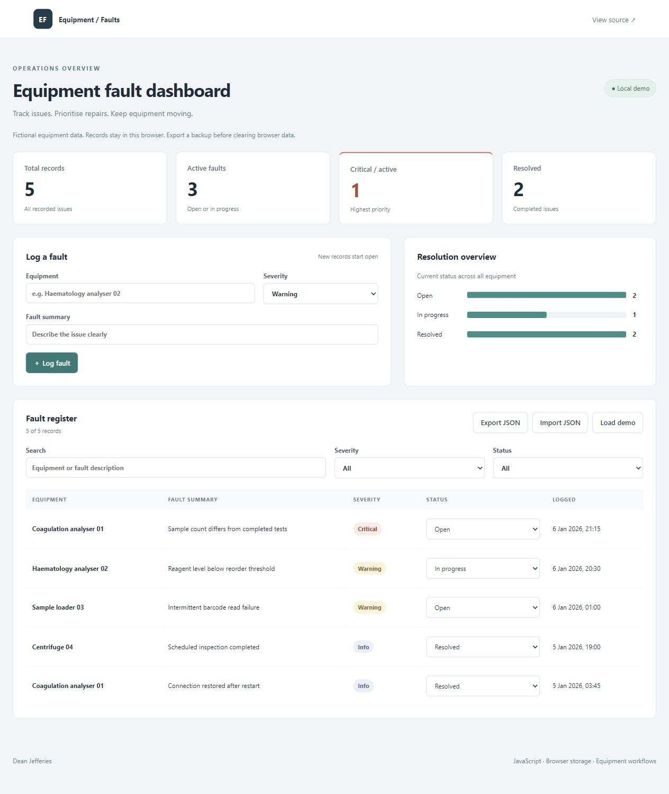

# Equipment Fault Dashboard

**JavaScript · Responsive interface · Local persistence · JSON import/export**

A browser application for recording fictional equipment issues, prioritising active faults and tracking repairs. Includes a searchable fault register, status chart and portable JSON backups.

**[Open the live demo](https://djefferies1993.github.io/equipment-fault-dashboard/)** · [Browse the source](https://github.com/DJefferies1993/equipment-fault-dashboard)



## Run locally

Install Node.js 20 or newer. No packages or build tools are required.

```sh
npm start
```

Open **http://127.0.0.1:4173**. Keep the server running while using the application. Opening `index.html` directly is not supported because the application uses JavaScript modules.

## Use the dashboard

1. The first visit displays five fictional equipment records.
2. Enter equipment, severity and a summary, then select **Log fault**.
3. Search by equipment or description and combine severity/status filters.
4. Use a row's status menu to move it to **In progress** or **Resolved**.
5. Select **Export JSON** to back up every record, including hidden rows.
6. **Import JSON** validates a backup and asks before replacing existing records. **Load demo** also asks before replacement.

Summary cards and the status chart show the full dataset; the register count describes the current filter. Records persist in this browser's local storage. Different browsers, origins and devices have separate datasets. Clearing site data removes records, so export first.

## How it works

| File | Responsibility |
|---|---|
| `model.js` | Validation, filtering, totals and demo records |
| `app.js` | Storage, user interactions and safe table rendering |
| `index.html` / `style.css` | Labelled forms and responsive presentation |
| `server.js` | Local server restricted to application files |
| `model.test.js` | Data rules and import boundary tests |
| `server.test.js` | Local HTTP serving and malformed-request checks |

No framework or remote service is needed. User text is rendered using DOM text properties. Imports are capped at 1,000 records and 2 MB; failed validation leaves current data untouched.

## Tests

```sh
npm test
```

Tests cover filter combinations, totals, JSON round trips, invalid imports and duplicate IDs. Server checks cover normal requests, HEAD responses, blocked files, unsupported methods and malformed paths. Browser checks cover forms, persistence and layout separately.

## Scope and development

A local demonstration without accounts, a shared server database, notifications or clinical decision support. It shows a current status distribution rather than historical repair trends. Prepared with AI assistance as a reference implementation for Dean Jefferies to inspect and extend.
